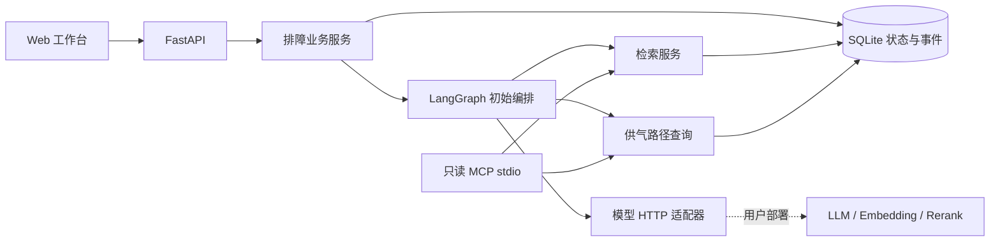

# 溯障核心版本方案

## 修订记录

| 版本 | 日期 | 摘要 |
|---|---|---|
| v1 | 2026-10-10 | 本地可运行架构、业务状态持久化与模型接口预留 |

## 技术方案

单进程 FastAPI 提供 REST 接口与静态工作台。SQLite 保存节点、供气边、压力快照、文档、切片、会话与事件。LangGraph 执行初始设备确认、证据采集与计划节点；反馈与人工确认由有状态业务服务执行，并原子写入状态快照及事件。

## 模块与边界

| 模块 | 职责 |
|---|---|
| `store.py` | 连接、事务、资料和会话快照、乐观锁与事件 |
| `ingest.py` | 文件解析、章节/段落分块、页码与字符范围 |
| `retrieval.py` | 中英文词元、BM25、精确故障码、余弦与 RRF |
| `topology.py` | 上下游 BFS、共同上游距离排序、图导入 DAG 校验 |
| `workflow.py` | 初始图节点、检查目标、反馈分支、人工结束条件 |
| `models.py` | 超时 HTTP 调用、向量/重排结构校验、模型引用校验 |
| `mcp_server.py` | 对外只读工具，直接复用内部服务 |
| `skills/air-supply.json` | 应用执行配置，记录技能 id 与版本 |

MCP 作为独立 stdio 服务可供外部 Agent 调用。当前应用内部直接调用共享业务服务，不通过 MCP 协议转发。技能配置为单场景固定技能，不是通用动态技能路由系统。

## 状态流转

`needs_info → checking → awaiting_confirmation → resolved`

无法核验、证据不足、范围不适用或全部检查未解释异常时进入 `handoff`；人工记录接管后为 `handed_off`。当前检查只能提交一次，反馈结果为正常、异常、未知。供气连接关系和测点快照不自动认定根因。

## 数据与恢复

每次反馈提交 `expected_revision`，更新条件包含会话 id 和版本号。状态更新和事件插入位于同一事务，冲突返回 409。引用与测点作为会话快照保存，后续资料导入不会改写历史依据。可恢复范围为一次 API 操作完成后；未实现 LangGraph 原生节点级 checkpointer 与进程崩溃后的节点续跑。

## 检索流程

先按型号与可选版本过滤。存在明确故障码匹配时只在匹配条目中 BM25 排序；否则使用中文单字/双字与英文词元 BM25。配置 Embedding 服务后，整份小语料获取向量、余弦排序，与 BM25 前 30 项通过 RRF 融合；可选 HTTP 重排前 20 项。未配置向量时不使用伪向量。

本地向量适配器限 500 个切片，超出显式降级。没有持久化向量索引与缓存；大型知识库应替换为 Elasticsearch/BGE 或其他索引服务。

## 接口

启动后访问 `/docs` 查看 Pydantic 自动生成的接口契约。主要接口为资料上传/新增/查询、搜索、图导入/查询、测点录入/查询、会话创建/补全/反馈/确认/导出。所有业务接口共享可选 Bearer 令牌；健康与页面静态资源可公开读取。

## 后续扩展

1. 在模型适配器接入用户部署的模型服务，跑真实评测样本。
2. 在检索服务替换持久向量索引，在拓扑服务替换 Neo4j 查询。
3. 添加 OCR 与大文档异步任务、告警时间窗分析、IoT/MES 接口。
4. 用 PostgreSQL 与原生 checkpointer 增强持久化，并补充用户、租户、资料权限及审核身份。
